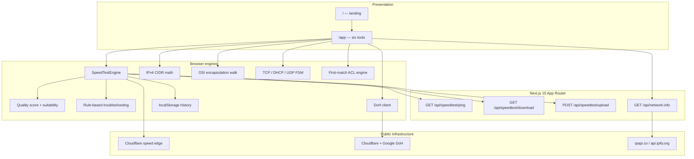

# SwiftNet

Browser-based network diagnostics: live HTTP/TCP speed tests, DNS-over-HTTPS lookup, IPv4 CIDR math, OSI packet walkthroughs, protocol handshake animations, and a first-match firewall ACL simulator. Unreachable endpoints surface as unavailable — results are never invented.

[](LICENSE)
[](https://nextjs.org/)
[](https://www.typescriptlang.org/)
[](https://react.dev/)

Repository: [github.com/Abhi666-max/SwiftNet](https://github.com/Abhi666-max/SwiftNet)

---

## Overview

| Capability | Implementation |
| --- | --- |
| Bandwidth, delay, jitter | Speed Lab against Cloudflare edge or local Next.js routes |
| Application-layer DNS | DNS-over-HTTPS inspector (RFC 8484 JSON APIs) |
| IPv4 addressing and CIDR | Subnet calculator (binary arithmetic in the browser) |
| OSI encapsulation | Packet Journey visualizer |
| TCP, UDP, DHCP | Protocol Playground state machines |
| Packet filtering / ACLs | First-match firewall simulator |

SwiftNet is not a certified lab meter and not an ICMP ping tool. Browsers cannot open raw sockets; latency is HTTP round-trip time measured with `performance.now()`.

---

## Architecture

Traffic never pretends to leave the machine when it does not need to. UI and scoring stay in the browser. Live tests call public resolvers and CDN edges; local fallback routes stream high-entropy bytes from the Next.js server.

```
                         _______________________________
                        /                               /|
                       /     Presentation (React 19)   / |
                      /     Landing  ·  /app suite    /  |
                     /_______________________________/   |
                     |  Tabs · Gauge · Recharts      |   |
                     |  History / compare / export   |  /
                     |_______________________________| /
                                    |
                         ___________v___________________
                        /                               /|
                       /   Client engines (TypeScript) / |
                      /   SpeedTestEngine · DoH · CIDR/  |
                     /   OSI walk · protocol FSM · ACL/   |
                    /________________________________/    |
                    |  Vitest: scoring + diagnostics |   /
                    |________________________________| /
                                    |
              ______________________v_______________________
             /                      |                       /|
            /  Next.js App Router   |  External networks   / |
           /________________________|_____________________/  |
           | /api/speedtest/ping    |  speed.cloudflare.com | |
           | /api/speedtest/download|  cloudflare-dns.com   | /
           | /api/speedtest/upload  |  dns.google           |/
           | /api/network-info      |  ipapi.co / ipify     |
           |________________________|_______________________|
```



**Data flow for a Speed Lab run**

1. Eight uncached HTTP probes build idle RTT and RFC 3550-style jitter.
2. Three concurrent download streams pull 1–20 MB high-entropy chunks; latency is sampled under load.
3. Upload streams POST binary payloads; latency is sampled again under load.
4. Bufferbloat delta = loaded RTT − idle RTT, graded A+ through F.
5. Score, suitability, and troubleshooting rules run locally. History stays in `localStorage` unless the user opts into storing public IP.

---

## Tools and how they work

### Speed Lab — transport / HTTP

Measures download Mbps, upload Mbps, idle latency, jitter, and loaded latency.

| Piece | Behaviour |
| --- | --- |
| Endpoints | Cloudflare `speed.cloudflare.com` (default) or SwiftNet `/api/speedtest/*` |
| Download | 3 parallel `fetch` streams, chunk sizes 1 MB → 20 MB, ~8.5 s window; slow-start trimmed; stable average of remaining samples |
| Upload | Binary POST with `XMLHttpRequest.upload.onprogress` |
| Latency | HTTP GET of empty/minimal bodies; **not** ICMP |
| Jitter | Mean absolute successive difference of RTT samples |
| Payloads | Local routes fill a 64 KB LCG buffer so gzip cannot inflate apparent throughput |
| Score | Weighted 0–100: download 30%, upload 20%, latency 25%, jitter 15%, bufferbloat 10% |
| Suitability | Thresholds for gaming, conferencing, 4K streaming, cloud gaming, browsing |
| History | Compare two runs; export JSON or CSV |

### DNS Inspector — application / DoH

Queries Cloudflare `1.1.1.1` and Google `8.8.8.8` with `application/dns-json`. Supported types: A, AAAA, MX, TXT, CNAME, NS. Each lookup records resolver RTT and raw answers. Speed Lab also benchmarks both resolvers as part of a full test.

### Subnet Calculator — network / IPv4

Client-side bitwise CIDR. Input: IPv4 address + prefix. Output: network, broadcast, first/last usable host, total vs usable hosts, subnet mask, wildcard, class, private-range flag, and dotted-binary forms. `/31` and `/32` follow the usual host-count special cases.

### Packet Journey — OSI

Step animation from layer 7 down to layer 1 (encapsulation) and back up (decapsulation). Each step shows PDU name, typical protocols, header sketch, and a sample encapsulation string (HTTP → TLS → session → TCP → IPv4 → Ethernet → bits).

### Protocol Playground — control-plane FSMs

Timed packet diagrams, not live captures:

- **TCP** three-way handshake (SYN / SYN-ACK / ACK) with sequence and acknowledgement numbers
- **DHCP DORA** (Discover, Offer, Request, Ack) including broadcast `0.0.0.0` → `255.255.255.255`
- **UDP** connectionless request/reply with no handshake

### Firewall Simulator — filtering

Ordered ACL: protocol, CIDR or exact IPs, port or port range, direction, ALLOW/DENY. Evaluation is **first match wins**, then implicit deny. Inject a synthetic packet and the UI shows which rules were checked and which one decided the fate.

---

## Quality score

| Component | Weight | Mapping |
| --- | --- | --- |
| Download | 30% | log10 scale, capped at 500 Mbps |
| Upload | 20% | log10 scale, capped at 200 Mbps |
| Idle latency | 25% | 100 at ≤ 15 ms, 5 at ≥ 160 ms |
| Jitter | 15% | 100 at ≤ 2 ms, 5 at ≥ 40 ms |
| Bufferbloat delta | 10% | 100 at ≤ 10 ms, 5 at ≥ 150 ms |

Tiers: Exceptional (≥ 90), Great (≥ 75), Good (≥ 60), Fair (≥ 40), Poor. Unit tests live in `src/lib/scoring.test.ts` and `src/lib/troubleshooting.test.ts`.

---

## Tech stack

| Layer | Choice | Role |
| --- | --- | --- |
| Language | TypeScript | Strict app and route types |
| Framework | Next.js 15 (App Router) | Pages, streaming API routes |
| UI | React 19 | Client tabs and landing |
| Style | Tailwind CSS 3 | Layout and theme |
| Icons | Lucide | Tool chrome |
| Charts | Recharts | Live throughput / latency series |
| Tests | Vitest | Score and insight rules |
| Hosting target | Node 18.18+ / Vercel | `next build` serverless routes |

No database, no auth, no cookies. Privacy toggle defaults to **not** persisting public IP in history.

---

## Repository layout

```
SwiftNet/
├── src/
│   ├── app/
│   │   ├── page.tsx                 landing
│   │   ├── layout.tsx               metadata
│   │   ├── globals.css
│   │   ├── app/page.tsx             diagnostic shell + tabs
│   │   └── api/
│   │       ├── network-info/route.ts
│   │       └── speedtest/
│   │           ├── ping/route.ts
│   │           ├── download/route.ts
│   │           └── upload/route.ts
│   ├── components/
│   │   ├── tabs/                    Speed, DNS, CIDR, OSI, protocols, firewall
│   │   ├── Speedometer.tsx
│   │   ├── LiveGraph.tsx
│   │   ├── MetricCard.tsx
│   │   ├── QualityScoreCard.tsx
│   │   ├── LoadedLatencyCard.tsx
│   │   ├── InsightsCard.tsx
│   │   ├── TroubleshootingCard.tsx
│   │   ├── DnsTestCard.tsx
│   │   ├── NetworkInfoCard.tsx
│   │   ├── HistoryModal.tsx
│   │   ├── CompareModal.tsx
│   │   ├── Header.tsx
│   │   └── Footer.tsx
│   ├── lib/
│   │   ├── speedtestEngine.ts
│   │   ├── scoring.ts
│   │   ├── troubleshooting.ts
│   │   ├── dnsTest.ts
│   │   ├── history.ts
│   │   ├── exportReport.ts
│   │   ├── scoring.test.ts
│   │   └── troubleshooting.test.ts
│   └── types/speedtest.ts
├── next.config.ts
├── tailwind.config.ts
├── package.json
└── LICENSE
```

---

## Run locally

Requires **Node.js 18.18+** (20+ recommended) and npm.

```bash
git clone https://github.com/Abhi666-max/SwiftNet.git
cd SwiftNet
npm install
npm test
npm run dev
```

Open [http://localhost:3000](http://localhost:3000). Production:

```bash
npm run build
npm start
```

Deploy with the default Next.js settings on Vercel if you want the local `/api/speedtest` routes on a public host. Cloudflare-edge tests work from any origin that the browser can reach.

---

## Limits (read before citing results)

- Latency is **HTTP RTT**, not ICMP echo.
- Throughput is **TCP over HTTPS** as seen by the browser: Wi-Fi, VPN, extensions, CPU, and distance to the edge all move the needle.
- DNS inspector talks to public DoH endpoints; corporate proxies may block them.
- Network-info uses request headers plus ipapi.co, with ipify as fallback. Rate limits yield partial records, never fabricated ISP names.
- Protocol and OSI panels are **animations**, not packet captures.

---

## Credits

| | |
| --- | --- |
| Author | [Abhijeet Kangane](https://github.com/Abhi666-max) |
| Purpose | Network diagnostics platform |
| Speed endpoints | [Cloudflare Speed Test](https://speed.cloudflare.com/) (`/__down`, `/__up`) |
| DNS | [Cloudflare DoH](https://developers.cloudflare.com/1.1.1.1/encryption/dns-over-https/), [Google Public DNS](https://developers.google.com/speed/public-dns/docs/doh) |
| Geo / IP | [ipapi.co](https://ipapi.co/), [ipify](https://www.ipify.org/) |
| UI | [Lucide](https://lucide.dev/), [Recharts](https://recharts.org/) |

Third-party services remain the property of their operators. SwiftNet only calls their public HTTP APIs from the user's browser or the Next.js server.

---

## License

[MIT](LICENSE) © 2026 Abhijeet Kangane.
